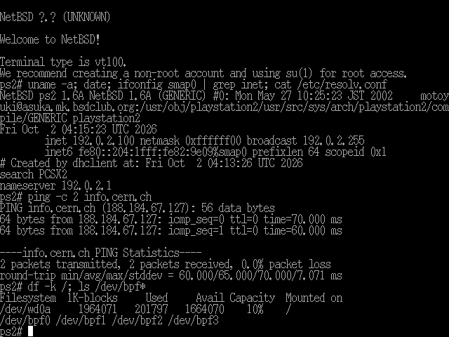

# NetBSD 1.6A/playstation2 on WhiteRhino

The 2002 **NetBSD/playstation2** port (NetBSD 1.6A, GENERIC kernel built 27 May 2002)
running in an emulator: it boots from an emulated hard disk to a multi-user `login:`,
with the USB keyboard, the hard disk and the network adapter working.



The emulator is [WhiteRhino](https://github.com/Arawn-Davies/whiterhino), a PCSX2 fork
for booting operating systems on the PS2, which loads the kernel through
[kernelreloaded](https://github.com/Arawn-Davies/kernelreloaded)'s kloader. Neither
gets there unpatched. This repository holds the kloader patches and the scripts that
patch the kernel and build a bootable disk. The emulator patches live in
[ajfa/ps2linux10-whiterhino](https://github.com/ajfa/ps2linux10-whiterhino), shared with
Sony's PS2 Linux 1.0.

No kernel, BIOS or other binaries are included.

## What was wrong

**The emulator** (patches 1 to 7 of
[ps2linux10-whiterhino](https://github.com/ajfa/ps2linux10-whiterhino#what-was-wrong-and-the-patches)):

| Symptom | Cause |
|---------|-------|
| init hangs right after the kernel starts | with the interpreter, COP0 Random did not move between two TLB refills, so both landed on the same entry and evicted each other forever |
| `sh` dies with SIGSEGV in `rc` | PCSX2's BIOS syscall HLE answered NetBSD's user-mode syscalls (`write(2, ...)` was taken for `GetOsdConfigParam`) |
| `ping` takes the emulator down | the interpreter ignored Status.CU1, so floating point never trapped to the kernel |
| bad MAC address checksum, every packet an error | a phantom bit in the emulated EEPROM, and SMAP TX status never cleared |
| no USB keyboard | NetBSD gives the OHCI the EE's view of IOP RAM (0x1c000000 + x); the emulated OHCI wants IOP bus addresses |
| `` ` `` and `~` missing | key mapping |

The EE has to run in the interpreter: the recompiler restarts into the BIOS when the
kernel probes the disk.

**kloader** (`patches/kernelreloaded`, against kernelreloaded
`9619ab7d6846baaba63c9b4037e7eb2e3774feb2`):

| # | Patch | Symptom without it |
|---|-------|--------------------|
| 1 | load the DEV9 relay on a fat PS2 under an emulator | no disk interrupts: the adapter probe does not see the emulated adapter |
| 2 | relay the SMAP interrupts too | every network packet times out |
| 3 | fill `bootinfo.boot_time` from the RTC | NetBSD reads month 0 and warns of a "preposterous clock" |

**The kernel** is built `root on ?` and has no ramdisk, so it stops at
`root device:`. `scripts/patch-rootspec.py` points it at `wd0a`.

**The disk.** There is no NetBSD 1.6 userland for playstation2, but hpcmips is the
same little-endian MIPS ABI and its binaries run unchanged. The port wants its
disklabel in sector 1 with no MBR, and its own device majors.

## Building

### 1. The emulator and kloader

```sh
git clone https://github.com/Arawn-Davies/kernelreloaded.git
cd kernelreloaded
git checkout 9619ab7d6846baaba63c9b4037e7eb2e3774feb2
git submodule update --init whiterhino      # pinned at 91c63d2
git am /path/to/this/repo/patches/kernelreloaded/*.patch
(cd whiterhino && git am /path/to/ps2linux10-whiterhino/patches/*.patch)
whiterhino/tools/build-kloader-resource.sh  # needs Docker; builds kloader.elf and kloader-instant.elf
```

Then build WhiteRhino as it describes (Linux, CMake, Qt 6); it bundles the two kloader
files from `whiterhino/bin/resources`, so build kloader first. The result used here is
`whiterhino/build/bin/pcsx2-qt`.

### 2. The kernel

You need the NetBSD 1.6A/playstation2 GENERIC kernel of 27 May 2002 (`netbsd-GENERIC.gz`,
MD5 `afd6ed94cc505fd658395ac56bb59442`). Older and newer snapshots of the port are in
[archive.org's playstation2-netbsd-snapshots](https://archive.org/details/playstation2-netbsd-snapshots);
they have not been tried here.

```sh
KERNEL=netbsd-GENERIC.gz OUT=media/kernel scripts/make-kernel.sh
```

This writes `media/kernel/netbsd` (patched for root on `wd0a`) and
`media/kernel/vmlinux.gz` (the same kernel for the emulator; kloader-instant only loads
a kernel with that name).

### 3. The hard disk (as root, on Linux)

```sh
SETS=media/sets scripts/fetch-sets.sh
sudo SETS=media/sets KERNEL_ELF=media/kernel/netbsd HDD=netbsd-ps2-hdd.raw scripts/build-hdd.sh
```

First download seven NetBSD 1.6 hpcmips sets with a web browser (archive.netbsd.org
cuts other clients short) from
<http://archive.netbsd.org/pub/NetBSD-archive/NetBSD-1.6/hpcmips/binary/sets/>:
`base`, `comp`, `etc`, `games`, `man`, `misc` and `text`, each `.tgz`, into
`media/sets`. `fetch-sets.sh` checks them against the release's MD5 sums and downloads
the port's `MAKEDEV` and `ttys` from the netbsd-1-6 branch.
`build-hdd.sh` needs `makefs` and `python3` and makes a 2 GB image: FFSv1 on `wd0a`,
128 MB of swap on `wd0b`. The first boot runs `MAKEDEV all`.

The system: host name `ps2`, `root` with no password, network by DHCP on `smap0`,
`cron` on, no mail server.

### 4. Running

```sh
scripts/run.sh
```

(see the top of the script for the paths it expects; the BIOS used here is SCPH-39001).
A penguin and "KernelReloaded" come first: that is the loader, not Linux. `login:`
appears about five minutes later. Log in as `root`.

To shut down: `shutdown -h now`, wait for `syncing disks... done`, then close the
window. If you close it without that, the next boot runs `fsck` and repairs the disk.

The network is the emulator's: NetBSD gets 192.0.2.100 by DHCP and the emulator
answers DNS itself (`ModeDNS1 = Internal`), so it works whatever the host's resolver
is.

## License

GPL-2.0, the license of kernelreloaded, which the kloader patches modify; see
`LICENSE`. NetBSD is under its own BSD licenses; the PS2 BIOS is Sony's. None of them
are part of this repository.
